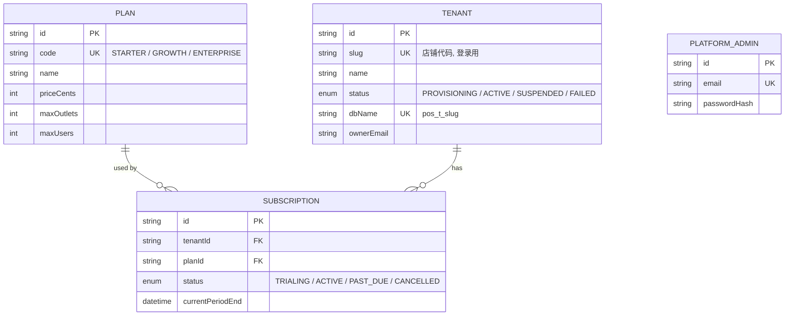
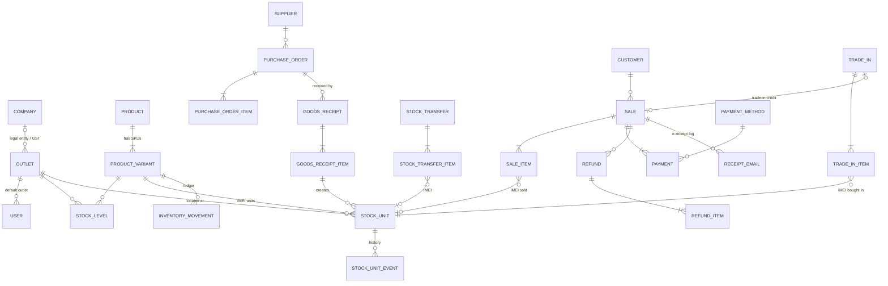
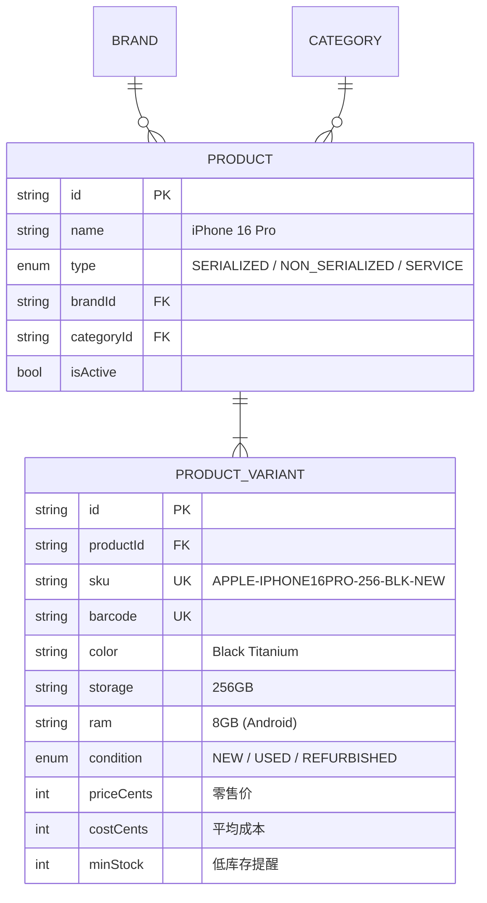
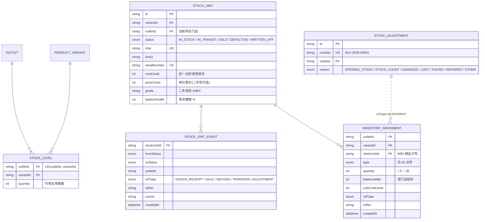
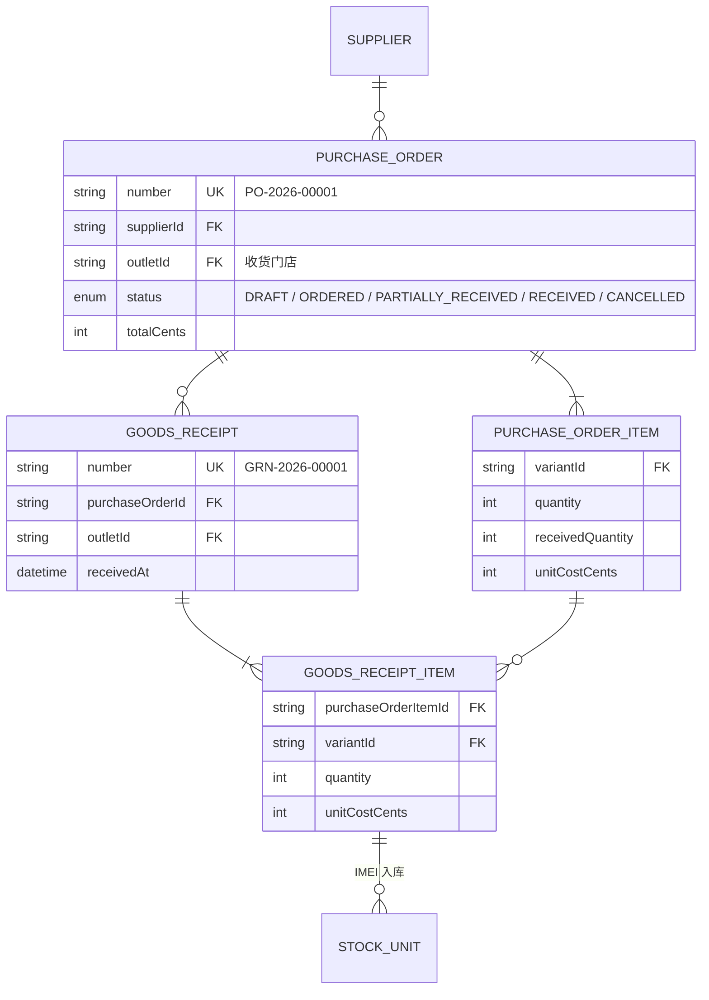
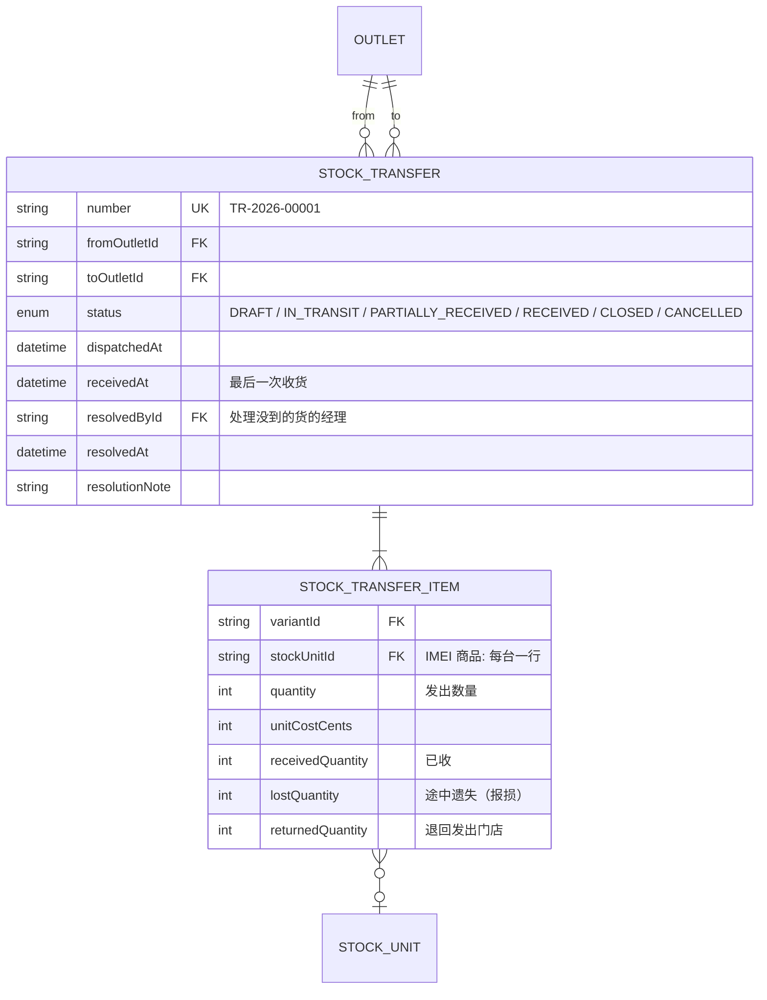
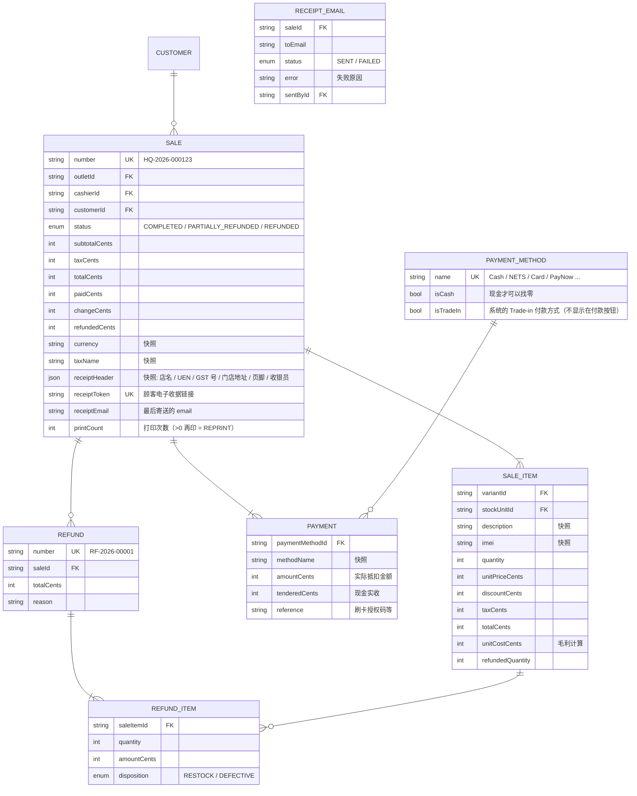
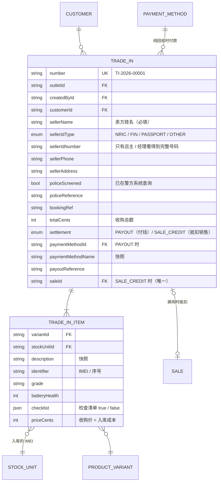

# 02 · 数据库 ERD（实体关系图）

> 真正的定义以 `prisma/control/schema.prisma` 和 `prisma/tenant/schema.prisma` 为准，本文件是给人看的说明。
> GitHub 会自动把下面的 Mermaid 代码渲染成图。

## 1. Control DB（SaaS 平台库）

## 2. Tenant DB（每家客户一个）

### 2.1 总览

### 2.2 ① 商品 Product Management

一个 **Product** = 一个型号（例：iPhone 16 Pro）；一个 **ProductVariant** = 一个 SKU（型号 + 颜色 + 容量 + 成色）。

| Product.type | 例子 | 库存方式 |
| --- | --- | --- |
| `SERIALIZED` | 手机、平板、手表、笔电 | 每台一条 `StockUnit`（IMEI / 序列号） |
| `NON_SERIALIZED` | 手机壳、保护贴、充电器 | 只记数量（`StockLevel`） |
| `SERVICE` | 贴膜服务费、维修工钱 | 不管库存 |

### 2.3 ② 库存 Inventory Management

- **StockLevel**：每个门店 × 每个 SKU 一行，是"各门店库存"的快速查询表。
- **StockUnit**：一台手机一行（IMEI 唯一）。卖掉后**不删除**，状态变 `SOLD`，以后可查完整生命周期（保修、回收都用得到）。
- **InventoryMovement**：库存流水（只增不改），任何数量变化都有一条记录。
- **StockUnitEvent**：IMEI 状态变化记录（包括不影响数量的变化，例如"退款故障机 SOLD → DEFECTIVE"）。

### 2.4 ③ 采购 Purchase Management

一张采购单可以分多次收货（每次一张 GRN），支持"部分到货"。

### 2.5 ④ 调货 Stock Transfer

在途数量 = `quantity − receivedQuantity − lostQuantity − returnedQuantity`。

### 2.6 ⑤ POS 销售 Sales

**快照原则**：销售明细保存当时的商品名、SKU、IMEI、价格、成本；销售单保存当时的收据抬头（店名、门店所属公司名、UEN、GST 号、门店地址 / 电话、页脚、收银员）、货币、税名和税率——之后改商品资料、设置、公司、门店或员工，都不会影响历史单据和收据。

**二手机收购（Trade-in，见 04 §6）**

- 换购时，销售单多一笔 `Payment`（`Trade-in` 付款方式，`reference` = TI 单号），`Sale.paidCents` 包含抵扣金额；GST 仍按销售全价计算。

### 2.7 组织与设置

| 表 | 说明 |
| --- | --- |
| `BusinessProfile` | 只有一行（id=1）：品牌名、UEN、GST 注册号（门店没有公司时用）、email（顾客回复电子收据）、货币、税率、是否含税、收据页脚、电话国家码（WhatsApp 用，默认 65）、Trade-in 规则（必须填卖方证件 / 必须警方查询，预设开启） |
| `Company` | 法律实体：公司名、UEN、是否 GST 登记、GST 号、地址（见 04 §7） |
| `Outlet` | 门店，`code` 唯一（例：HQ、TPY、JUR），用于销售单号前缀；`companyId` 可选（没有 = 用 BusinessProfile 的资料） |
| `User` | 员工：email 唯一、角色、默认门店、是否启用 |
| `DocumentSequence` | 单号流水：`key` → 当前值 |
