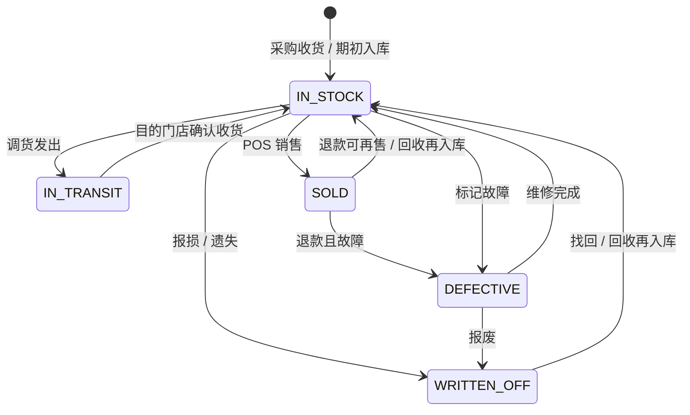

# 03 · 库存状态设计 (Inventory State Design)

手机店库存有两种：

1. **IMEI / 序列号商品**（`SERIALIZED`）：每台独立追踪，用 `StockUnit` 的**状态机**管理。
2. **数量商品**（`NON_SERIALIZED`，配件）：只追踪各门店数量，用 `StockLevel` + `InventoryMovement`。

两种商品的数量变化都会写进同一本**库存流水**（`InventoryMovement`）。

## 1. IMEI 状态机（StockUnit.status）



| 状态 | 意思 | 算不算"可售库存" | `outletId` 指的是 |
| --- | --- | --- | --- |
| `IN_STOCK` | 在门店，可以卖 | ✅ 是 | 所在门店 |
| `IN_TRANSIT` | 调货途中 | ❌（算"在途"） | 发出门店（收货后改为目的门店） |
| `SOLD` | 已卖出 | ❌ | 卖出的门店 |
| `DEFECTIVE` | 故障 / 待维修 | ❌ | 所在门店 |
| `WRITTEN_OFF` | 已报损 / 遗失 / 报废 | ❌ | 最后所在门店 |

**允许的状态转换**写在 `src/modules/inventory/unit-state.ts`（有单元测试）。代码里任何状态变化都必须经过 `inventory` 模块，不允许直接 `update` StockUnit。

> **同一个 IMEI 可以再回来**：如果顾客把以前买的手机卖回给店里（回收），收货时系统发现该 IMEI 已存在且是 `SOLD` / `WRITTEN_OFF`，会**重新启用同一条记录**（可以改成二手 SKU、新的成本），所以一个 IMEI 的完整历史（第一次进货 → 卖出 → 回收 → 再卖）都在同一页。

## 2. 库存流水类型（InventoryMovement.type）

| 类型 | 数量 | 触发 | 单据 refType |
| --- | --- | --- | --- |
| `PURCHASE_RECEIPT` | + | 采购收货 | `GOODS_RECEIPT` |
| `SALE` | − | POS 销售 | `SALE` |
| `SALE_RETURN` | + | 退款并回库（可再售） | `REFUND` |
| `TRANSFER_OUT` | − | 调货发出（发出门店） | `TRANSFER` |
| `TRANSFER_IN` | + | 调货收货（目的门店） | `TRANSFER` |
| `ADJUSTMENT_IN` | + | 期初入库、盘盈、找回、维修完成 | `ADJUSTMENT` |
| `ADJUSTMENT_OUT` | − | 盘亏、损坏、遗失、标记故障 | `ADJUSTMENT` |

- IMEI 商品：**每台一条**流水（`stockUnitId` 有值，数量 ±1）。
- 配件：每张单据每个 SKU 一条流水（数量 ±N）。
- `balanceAfter` = 这条流水之后，该门店该 SKU 的结存数量。
- 不影响"可售数量"的变化（例如退款时直接判定故障：`SOLD → DEFECTIVE`）不写流水，只写 `StockUnitEvent`。

## 3. 库存不变量（Invariants）

系统必须一直满足下面几条，任何代码修改都不能破坏：

1. `StockLevel(门店, SKU).quantity` = 该门店该 SKU 所有 `InventoryMovement.quantity` 之和
2. IMEI 商品：`StockLevel.quantity` = 该门店该 SKU 状态为 `IN_STOCK` 的 `StockUnit` 数量
3. `StockLevel.quantity ≥ 0`（v1 不允许负库存）
4. 在途数量 = 状态为 `IN_TRANSIT` 的调货单明细数量之和
5. 每一次 `StockUnit.status` 变化都有一条 `StockUnitEvent`

对账 SQL（在租户库执行，结果应为 0 行）：

```sql
-- 不变量 1：StockLevel 与流水是否一致
SELECT sl."outletId", sl."variantId", sl.quantity, COALESCE(SUM(m.quantity), 0) AS ledger
FROM "StockLevel" sl
LEFT JOIN "InventoryMovement" m ON m."outletId" = sl."outletId" AND m."variantId" = sl."variantId"
GROUP BY sl."outletId", sl."variantId", sl.quantity
HAVING sl.quantity <> COALESCE(SUM(m.quantity), 0);

-- 不变量 2：IMEI 商品的 StockLevel 与 IN_STOCK 台数是否一致
SELECT sl."outletId", sl."variantId", sl.quantity, COUNT(u.id) AS units
FROM "StockLevel" sl
JOIN "ProductVariant" v ON v.id = sl."variantId"
JOIN "Product" p ON p.id = v."productId" AND p.type = 'SERIALIZED'
LEFT JOIN "StockUnit" u ON u."variantId" = sl."variantId" AND u."outletId" = sl."outletId" AND u.status = 'IN_STOCK'
GROUP BY sl."outletId", sl."variantId", sl.quantity
HAVING sl.quantity <> COUNT(u.id);
```

## 4. 并发控制

两个收银员同时卖同一台手机、或同时卖最后一个配件时：

- **IMEI**：用条件更新（Compare-and-Set）：`UPDATE "StockUnit" SET status='SOLD' WHERE id=? AND status='IN_STOCK' AND "outletId"=?`。没有更新到任何行 → 报错"该 IMEI 已被处理"，整个交易回滚。
- **数量**：`UPDATE "StockLevel" SET quantity = quantity - n WHERE ... AND quantity >= n`。没有更新到 → "库存不足"。
- 单据 + 库存在同一个数据库事务内完成。

## 5. 成本（毛利计算用）

- **IMEI 商品**：每台的真实进货成本存在 `StockUnit.costCents`，卖出时复制到 `SaleItem.unitCostCents`。
- **配件**：移动加权平均成本，存在 `ProductVariant.costCents`，每次采购收货时更新：
  `新平均成本 = (原总数量 × 原平均成本 + 本次数量 × 本次成本) ÷ (原总数量 + 本次数量)`
- 调货不改变成本。

## 6. 门店库存查询

| 需要 | 数据来源 |
| --- | --- |
| 各门店可售库存 | `StockLevel` |
| 某台手机在哪里、什么状态 | `StockUnit`（按 IMEI 搜索） |
| 某台手机的完整历史 | `StockUnitEvent` + 销售明细 |
| 某门店某 SKU 的进出记录 | `InventoryMovement` |
| 在途库存 | `StockTransfer`（`IN_TRANSIT`）的明细 |
| 低库存提醒 | `StockLevel.quantity ≤ ProductVariant.minStock`（`minStock > 0`） |
