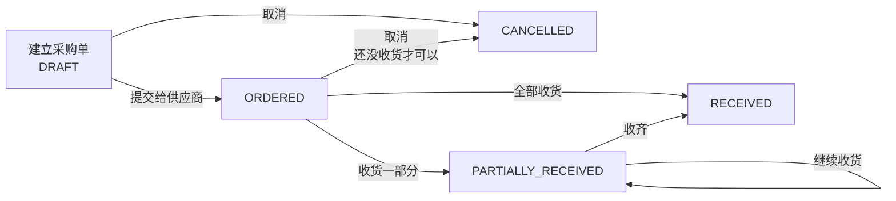
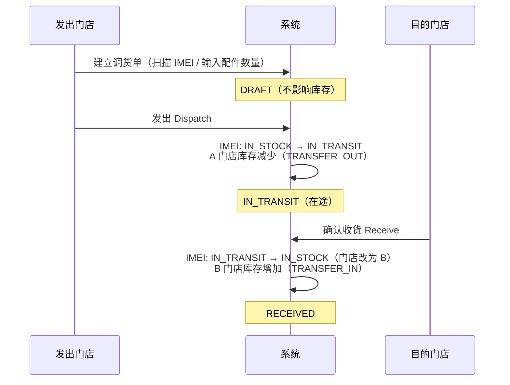
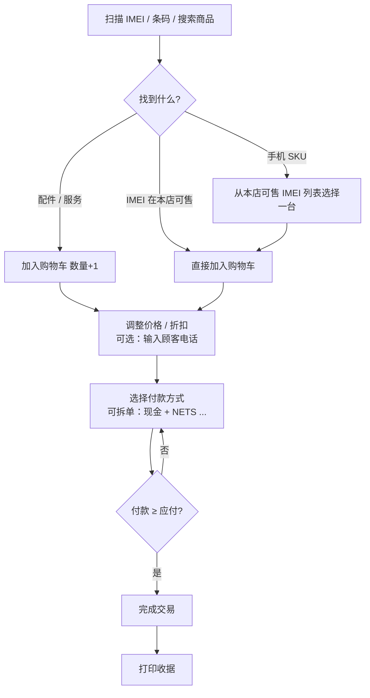
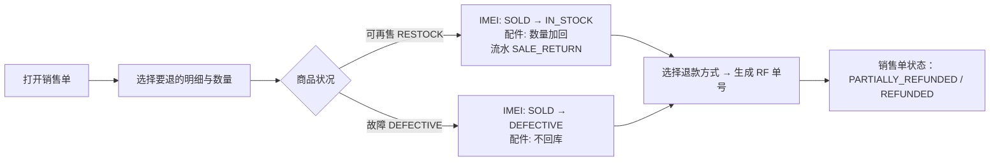
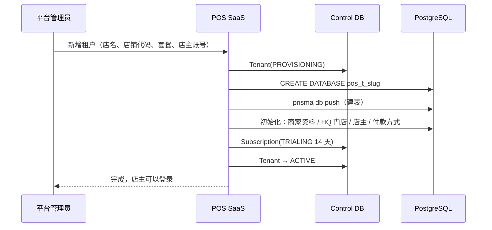

# 04 · 业务流程 (Business Flows)

## 1. 采购 → 收货入库（Purchase Management）

**收货（Goods Receipt）步骤**（一个数据库事务）：

1. 选择采购单，输入本次每个 SKU 的收货数量（不能超过未收数量）
2. IMEI 商品：扫描每一台的 IMEI / 序列号（数量必须一致）。二手机可以在同一行加成色和电池：`356789012345678,A,87`
3. 系统检查 IMEI：格式（15 位 + Luhn 校验）、本批次不重复、系统里没有在库的同号
4. 建立 GRN（`GRN-2026-00001`）→ 每台建 `StockUnit(IN_STOCK)` → 加 `StockLevel` → 写流水 `PURCHASE_RECEIPT`
5. 配件更新移动平均成本
6. 更新采购单已收数量与状态

> 草稿（DRAFT）采购单也可以直接收货——小店常常是"货到了才开单"。

## 2. 门店调货（Stock Transfer）

| 状态 | 可以做的动作 | 谁可以做 |
| --- | --- | --- |
| `DRAFT` | 发出、取消 | 店主 / 经理 |
| `IN_TRANSIT` | 确认收货 | 店主 / 经理 / 目的门店的收银员 |
| `RECEIVED` | – | – |
| `CANCELLED` | – | – |

> v1：发出后不能取消，只能整单收货。缺货、部分收货留到 v2（见 roadmap）。

## 3. POS 收银（POS Sales）

**完成交易时（一个数据库事务）**：

1. 重新读取商品资料、校验价格与数量（以服务器为准）
2. 计算税（每一行：含税时 `税 = 净额 × 税率 ÷ (1 + 税率)`）
3. 分配付款：非现金付款不能超过应付；超出部分只能是现金 → 计算找零
4. 生成单号 `HQ-2026-000123`
5. 每一行出库：IMEI `IN_STOCK → SOLD`（条件更新防止重复卖）、配件扣数量，写流水 `SALE`，记录成本
6. 保存销售单、明细、付款

## 4. 退款（Refund）

- 只有店主 / 经理可以退款。
- 退款金额按明细比例计算（含税）；同一行最后一次退款自动取剩余金额，避免分数误差。
- 退回的商品进入**做退款的门店**的库存。

## 5. 库存调整（Stock Adjustment）

| 类型 | 用途 | 效果 |
| --- | --- | --- |
| 入库 STOCK_IN | 期初库存、盘盈、找回 | 配件加数量；IMEI 商品输入 IMEI 建立新的 `StockUnit` |
| 出库 STOCK_OUT | 盘亏、损坏、遗失（配件） | 扣数量 |
| IMEI 状态 UNIT_STATUS | 标记故障 / 报损 / 恢复可售 | 按状态机转换，必要时加减库存 |

> **开始使用系统时**：用"入库 → 原因：期初库存（OPENING_STOCK）"把现有的手机 IMEI 和配件数量录进去。

## 6. 开通新租户（SaaS Provisioning）

