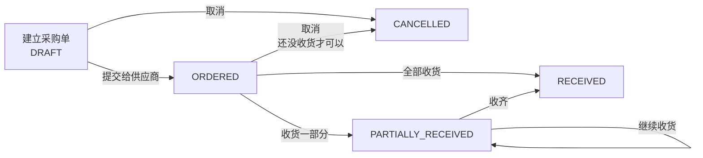
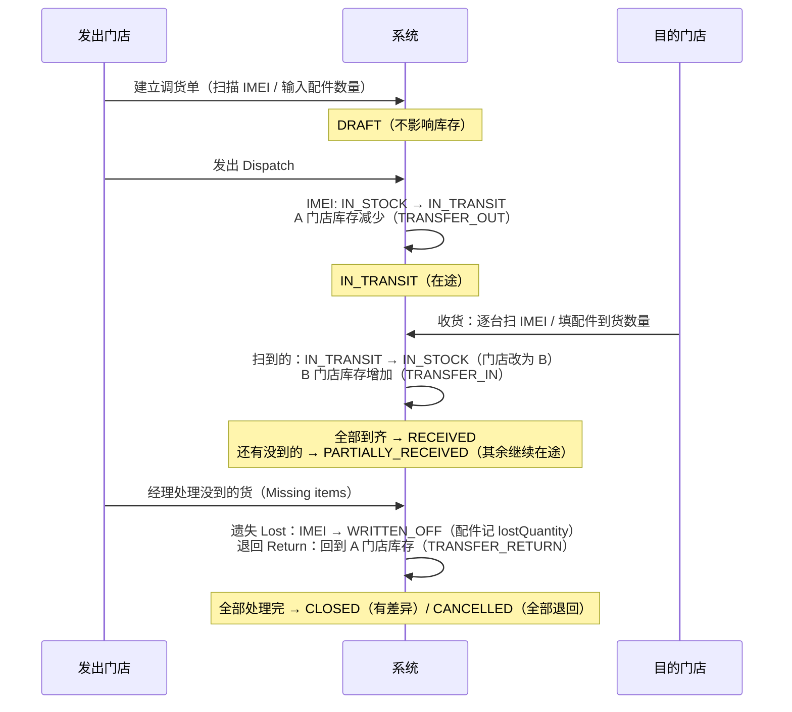
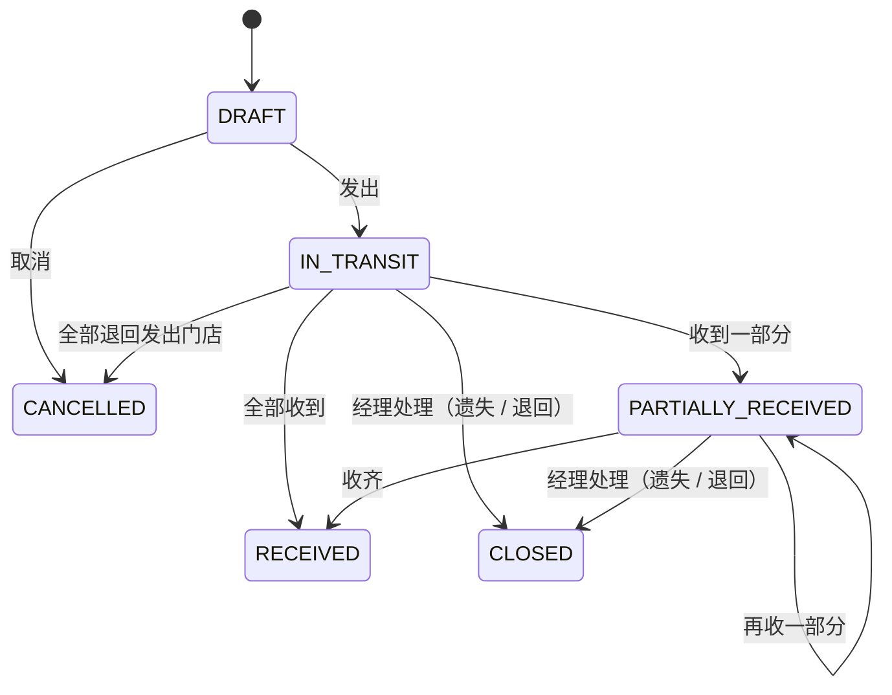
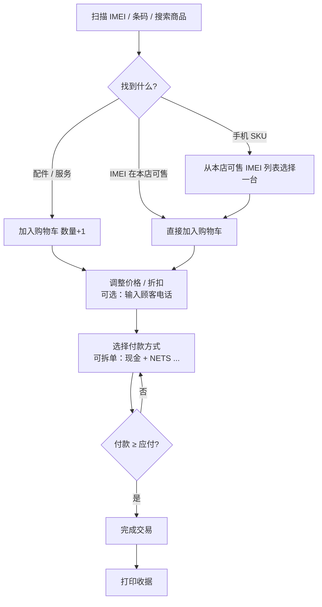
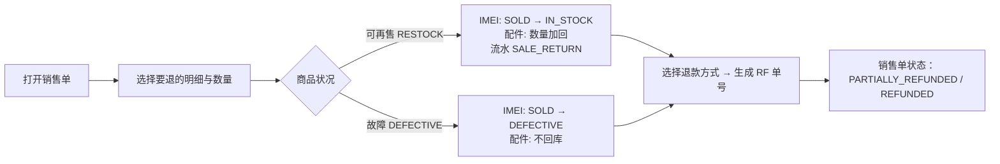
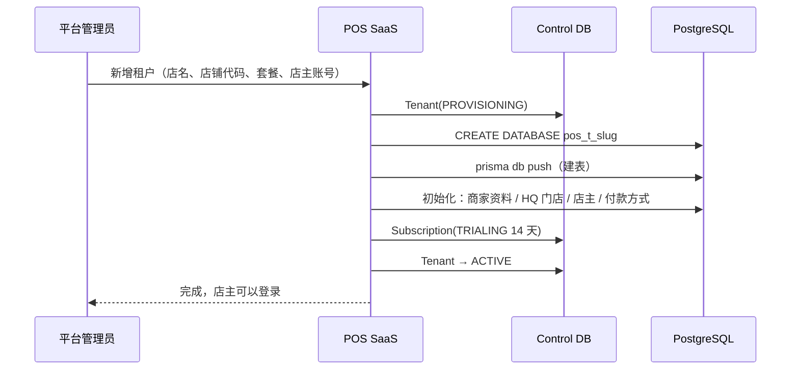

# 04 · 业务流程 (Business Flows)

## 1. 采购 → 收货入库（Purchase Management）

**收货（Goods Receipt）步骤**（一个数据库事务）：

1. 选择采购单，输入本次每个 SKU 的收货数量（不能超过未收数量）
2. IMEI 商品：扫描每一台的 IMEI / 序列号——扫描枪每扫一台就加一行；也可以一次贴上很多个（换行、逗号、空格分隔都可以）。
   确认前会先列出清单（每台一行），数量和金额即时更新。二手 / 翻新机在清单里逐台选成色（A+ / A / B / C / D）、填电池健康（0–100%）
3. 系统检查 IMEI：格式（15 位 + Luhn 校验）、本批次不重复、系统里没有在库的同号；看不懂的值留在输入框并提示，不会被猜成别的字段
4. 建立 GRN（`GRN-2026-00001`）→ 每台建 `StockUnit(IN_STOCK)` → 加 `StockLevel` → 写流水 `PURCHASE_RECEIPT`
5. 配件更新移动平均成本
6. 更新采购单已收数量与状态

> 草稿（DRAFT）采购单也可以直接收货——小店常常是"货到了才开单"。

## 2. 门店调货（Stock Transfer）

| 状态 | 意思 | 可以做的动作 | 谁可以做 |
| --- | --- | --- | --- |
| `DRAFT` | 草稿，还没发出 | 发出、取消 | 店主 / 经理 |
| `IN_TRANSIT` | 在途，什么都还没收 | 收货（全部或部分）；处理没到的货 | 收货：店主 / 经理 / 目的门店的收银员；处理：店主 / 经理 |
| `PARTIALLY_RECEIVED` | 收了一部分，其余在途 | 同上 | 同上 |
| `RECEIVED` | 全部收到 | 寄回（开一张反方向的调货单） | 店主 / 经理 |
| `CLOSED` | 已结束，但有遗失 / 退回 | 寄回 | 店主 / 经理 |
| `CANCELLED` | 草稿取消，或发出后全部退回 | – | – |

- **没到的货**：先别急着处理——之后到了还可以再收。确定找不到才选"遗失"（报损），确定根本没寄出 / 被送回才选"退回"。处理不能撤销。
- **寄错 / 坏了**：先收货，再在调货单上按「Send items back」，系统会预先填好一张反方向的调货单（只包含这张单收到、而且还在本店的货）。
- 每一行明细记录：发出 `quantity`、已收 `receivedQuantity`、遗失 `lostQuantity`、退回 `returnedQuantity`；在途 = 发出 − 已收 − 遗失 − 退回。

## 3. POS 收银（POS Sales）

**完成交易时（一个数据库事务）**：

1. 重新读取商品资料、校验价格与数量（以服务器为准）
2. 计算税（每一行：含税时 `税 = 净额 × 税率 ÷ (1 + 税率)`）
3. 分配付款：非现金付款不能超过应付；超出部分只能是现金 → 计算找零
4. 生成单号 `HQ-2026-000123`
5. 每一行出库：IMEI `IN_STOCK → SOLD`（条件更新防止重复卖）、配件扣数量，写流水 `SALE`，记录成本
6. 保存销售单、明细、付款，以及**收据快照**：店名、UEN、GST 号、门店名称 / 地址 / 电话、收据页脚、收银员、货币、税名（`Sale.receiptHeader` 等）

### 收据（打印 / 电子收据）

- 收据内容只来自销售单的快照——之后改设置、改门店地址、改员工名字，**旧收据都不会变**（会计 / 税务上，开出去的单据要保持开单时的内容）。
- 第一次打印是正本；之后每次打印都会印上 **`*** REPRINT ***`**（`Sale.printCount`），防止拿重复收据去退款或报销。
- **电子收据（email）**：POS 可选填顾客 email（老顾客自动带出）→ 完成交易后自动寄出；寄送结果（成功 / 失败原因）记录在 `ReceiptEmail`，销售单页面可以重发。
  邮件内容与纸本收据相同（含 IMEI，可作保修凭证），并附顾客专属链接 `/r/<店铺代码>/<token>`（不需要登录，128 位随机 token；电话号码只显示后 4 位），顾客可在那里存成 PDF。
- 寄件人：名称 = 店名，地址 = `MAIL_FROM`（SMTP 设定在 `.env`）；顾客回复会寄到 Settings 里的店铺 email。
- **WhatsApp**：按钮会打开 WhatsApp（`wa.me` 链接），顾客号码和收据内容已填好，店员按「发送」。免费，不需要 API。
- 顾客 email 只用来寄收据（PDPA）；要拿来发促销，需另外取得同意。

## 4. 退款（Refund）

- 只有店主 / 经理可以退款。
- 退款金额按明细比例计算（含税）；同一行最后一次退款自动取剩余金额，避免分数误差。
- 退回的商品进入**做退款的门店**的库存。

## 5. 库存调整（Stock Adjustment）

| 类型 | 用途 | 效果 |
| --- | --- | --- |
| 入库 STOCK_IN | 期初库存、盘盈、找回 | 配件加数量；IMEI 商品输入 IMEI 建立新的 `StockUnit` |
| 出库 STOCK_OUT | 盘亏、损坏、遗失（配件） | 扣数量 |
| IMEI 状态 UNIT_STATUS | 标记故障 / 报损 / 恢复可售 | 按状态机转换，必要时加减库存 |

> **开始使用系统时**：用"入库 → 原因：期初库存（OPENING_STOCK）"把现有的手机 IMEI 和配件数量录进去。

## 6. 开通新租户（SaaS Provisioning）

